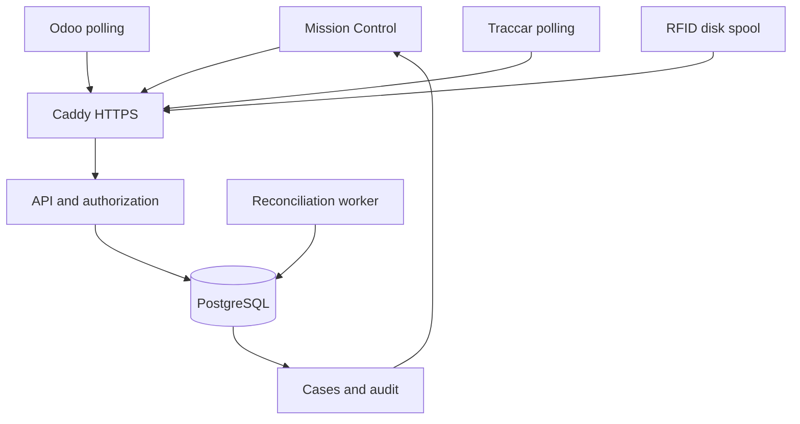

# Runtime architecture and invariants — 0.2

The API and worker share PostgreSQL. SQLite is a development backend only; production startup rejects it. Application packages include the cockpit assets, adapters and optional Temporal source. Container runtime is non-root and read-only.

## Data and concurrency

Migrations run under a database-wide transaction lock. Existing MK0 SQLite schemas are upgraded in place; production data transfer uses `python -m rally.migrate_sqlite` on a backup copy. Schema versions are persisted in `schema_migrations`.

All business writes acquire the same PostgreSQL transaction advisory lock (SQLite uses BEGIN IMMEDIATE). This intentionally serializes writes across API and worker processes, prioritizing consistency at moderate volume. There is no claim of high-throughput telemetry capacity. Scale changes require profiling and a tenant-scoped locking redesign; adding API replicas alone will not increase write throughput.

- Credential lookup determines tenant; request bodies cannot select it.
- PostgreSQL compound foreign keys protect asset/job relationships within the same tenant.
- A partial unique index permits at most one active custody per asset.
- Custody mutation, audit and idempotency response commit together.
- Completion reads and writes in the same transaction as its audit.
- Evidence replay lookup and insertion share a transaction; same ID with different content conflicts.
- Reconciliation reads active custody and writes exceptions in a single transaction, preventing stale-snapshot closure.
- Acknowledgment and notes cannot resolve an outstanding condition. Only supported deterministic conditions clear automatically after business state changes; every closure records why.
- Observations and audit are append-only through the API, not tamper-proof against database administrators.

## Identity

Each access token resolves to one named identity and tenant. Connector credentials are source-scoped and cannot browse assets, custody or work orders. Manual cockpit identities can submit manual/QR evidence; they cannot impersonate a sensor source. A source-scoped token authenticates the submitter, not the physical truth of a reading.

## Background operation

The reconciliation worker scans tenant state every configured interval. A crash does not lose the exception source: the next cycle derives it again from persisted custody. Worker success is recorded in the database. `/readyz` returns 503 if the worker is stale or the database is unavailable.

Odoo and Traccar run in separate supervised processes, one tenant/provider credential per process. They send health heartbeats. Missing heartbeats mean unknown/stale coverage, never proof that nothing failed. Traccar polls current positions; it does not promise a complete historical GPS track between polls. RFID retains normalized events locally before delivery and deletes them after successful API acknowledgment.

Temporal is an optional read-only review example, excluded from the production dependency set. Core recovery ownership, notes and automatic verification work without it. No external ERP writes or arbitrary recovery side effects are implemented.

## Boundaries

List endpoints return at most 500 rows; default 200, with `offset` pagination and stable ordering by timestamp + ID. Pagination is a live view, not a point-in-time export: concurrent inserts may shift pages. The UI deduplicates loaded records; Refresh starts a fresh view. Audit and evidence bulk archival should use a database snapshot.

This is a single-region, single-database deployment design. High availability, point-in-time recovery and external immutable audit storage are deployment responsibilities, not claims made by this repository.
