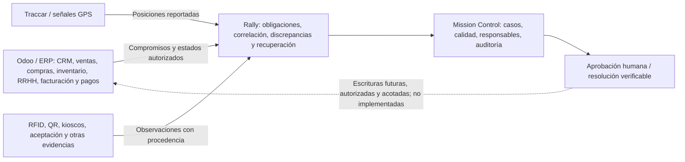

# Rally — Extensión transversal de dominios Odoo (anexo aditivo)

**Estado:** diseño de integración / backlog; **NO** significa que esos módulos se hayan conectado a un Odoo real.
**Fecha:** 2026-10-13.
**Referencia del usuario:** repositorio privado `em3rc0dTh/Odoo`, rama `main`, commit `2ce154b32050df2dc07e22898d4def9bc0dca562`.
**Destino:** repositorio `em3rc0dTh/Rally`. El código de la referencia no se copia, ni sus datos/credenciales.

## 1. Rectificación del alcance: Odoo no es solo órdenes de trabajo

Odoo funciona como un conjunto de aplicaciones ERP/CRM cuyo alcance concreto depende de la edición, versión, licencia, módulos instalados, personalizaciones y permisos. Contabilidad, facturación, pagos, empleados, nóminas, vacaciones, gastos, compras, inventario y CRM **son dominios posibles**, no endpoints listos en todos los servidores.

**Decisión:** Rally es la capa de *Business Execution Assurance* transversal: captura compromisos de una fuente autorizada; recibe observaciones; detecta discrepancias; coordina responsable, revisión, evidencia y resolución. El sistema ERP conserva sus registros legales/contables/administrativos; Rally NO debe convertirse en un ERP paralelo.



## 2. Qué está respaldado por el repositorio Odoo del usuario

| Área | Referencias concretas en `em3rc0dTh/Odoo` | Nivel de evidencia |
| --- | --- | --- |
| CRM, clientes y oportunidades | `CRM_SCRIPTS_README.md`, `fetch_crm_info.py`, `crm-lite/` — `res.partner`, `crm.lead`, equipos de ventas | Scripts, documentación y UI de referencia; su existencia no demuestra producción ni permisos vigentes |
| Empleados, asistencia, vacaciones | `get_thradex_employees.py`, `fetch_attendances.py`, `fetch_time_off.py`, `OdooAttendance/services/OdooService.ts` | Integraciones/código específicos y prototipos de cliente |
| Excepciones de RRHH | `DOCS_ERPLITE.md`, `app.py`, `erp-lite-web/src/app/dashboard/page.tsx` | Flujo documentado de tardanzas, faltas, justificaciones, expiración y aprobación |
| Nómina | `fetch_payroll.py`, `odoo_hr_management.py`, `erp-lite-web/src/app/dashboard/payroll/` | Consulta a `hr.payslip` y UI; no es certificación legal de nómina |
| Compras, proveedores | `fetch_purchase_orders.py`, `create_purchase_order.py`, `app.py` (rutas `/api/procurement`) | Lecturas y escrituras experimentales a `purchase.order`; **no** trasladar esas escrituras a Rally |
| Inventario | `get_inventory.py` — `stock.warehouse`, `stock.quant`, `product.product` | Script de lectura/extracción; no hay certificación de inventario físico |
| Gastos y reembolsos | `app.py` (ruta `/api/expenses`, modelo `hr.expense`), `erp-lite-web/src/app/dashboard/expenses/` | Lectura y UI de gastos |
| Contabilidad, facturas y pagos | Capacidades generales de Odoo, pero **no identificamos un adaptador equivalente a `account.move` o `account.payment` en este repo** | **Propuesta nueva pendiente**. No afirmar que se ha implementado o integrado |

**Versión/API:** la referencia contiene integraciones históricas XML-RPC (`/xmlrpc/2`), mientras que el adaptador actual de Rally apunta a Odoo 19 JSON-2. La compatibilidad se debe comprobar por instancia: NO copiar la autenticación XML-RPC ni prometer que modelos/campos del repo histórico funcionarán sin más en Odoo 19.

## 3. Matriz de extensiones *que se deben añadir* a Rally

Cada fila es **candidato de integración read-only**, no una fuente actualmente conectada.

| Dominio Rally | Modelos/identidades candidatos (validar módulo instalado) | Compromiso o expectativa | Discrepancias candidatas |
| --- | --- | --- | --- |
| CRM / Customer Promise | `res.partner`, `crm.lead` | Oportunidad ganada y próxima obligación explícita | Handoff a operaciones sin responsable, cliente/compañía incompatibles |
| Sales / Work Execution | `sale.order` y orden FSM/tarea **solo si el despliegue las define** | Orden/servicio aceptado, recurso y fecha | Trabajo cerrado sin evidencia, obligación vencida |
| Procurement / Vendor | `purchase.order`, recepciones de inventario según módulos | Pedido aceptado y recepción pactada | Recepción tardía, faltante o documento no conciliado |
| Inventory / Asset Traceability | `stock.quant`, `stock.picking`, `stock.lot` donde corresponda | Cantidad/disponibilidad/reserva y custodia del equipo | Diferencia stock vs observación física, equipo no devuelto |
| Workforce / Attendance | `hr.employee`, `hr.attendance`, `hr.leave` | Turno y marcación esperada, ausencia aprobada | Inasistencia, tardanza sin justificar, aprobación pendiente |
| Payroll / Expenses | `hr.payslip`, `hr.expense` si existen | Cierre/aprobación administrativa, rendición pendiente | Estado atascado, gasto sin revisión o excepción vencida |
| Accounting / Invoices | `account.move` con tipos y accesos permitidos | Emisión/aprobación y vencimiento de documento | Factura pendiente/no emitida después de condición aprobada |
| Payments / Collections | `account.payment`, estados de conciliación autorizados | Referencia de cobro/pago conciliada por el ERP | Operación reportada pero no conciliada, duplicidad o falta de referencia |

**Seguridad financiera:** `payment_state`, `account.payment` o un webhook de pasarela no prueban por sí solos liquidación bancaria. No se deben emitir pagos, contabilizar asientos, aprobar nómina ni reconciliar cuentas automáticamente desde Rally sin un proyecto explícito, permisos separados, doble autorización, idempotencia y conciliación certificada.

**Seguridad laboral y datos sensibles:** no copiar salarios, datos biométricos, reconocimiento facial, expedientes de RRHH, coordenadas personales o justificaciones completas a un panel general. Priorizar referencia, estado, momento, causal, fuente y control de acceso por dominio. Las reglas de privacidad, consentimiento, retención y protección de datos son obligatorias antes de un despliegue de clientes.

## 4. Contrato transversal sugerido (no implementado)

No modelar cada módulo como si fuera `sale.order`. Un contrato nuevo debe garantizar:

```json
{
  "source_system": "odoo",
  "source_instance": "customer-approved-instance",
  "company_id": "company-within-tenant-allowlist",
  "entity_model": "purchase.order",
  "entity_external_id": "123",
  "obligation_type": "supplier_delivery_due",
  "expected_state": "received",
  "due_at": "2026-11-01T18:00:00Z",
  "observed_state": "pending",
  "source_observed_at": "2026-10-30T10:00:00Z",
  "evidence_refs": [],
  "quality": "unknown",
  "case_status": "unassessed"
}
```

El ejemplo es **esquemático**, no un registro real ni un payload admitido por la API 0.3. El diseño definitivo debe tener esquema versionado, estados por dominio y trazabilidad de origen.

Invariantes propuestos:
1. Identidad externa compuesta `tenant + provider + instance + company + model + record_id`; **prohibida** la colisión entre empresas.
2. Sólo lectura de ERP inicialmente, desde un servicio con secretos fuera del navegador; ámbitos de empresa, modelo, campos y dominios explícitos y fail-closed.
3. Datos sensibles minimizados, campos autorizados por dominio, RBAC/ABAC y segregación de funciones (Finanzas/RRHH/Operaciones).
4. Upsert idempotente por identidad + versión/cursor; mantener historial de transiciones, no confundir estado actual con eventos completos.
5. Proveniencia, `observed_at`, `received_at`, estado de cobertura y valores `unknown/stale` explícitos. Una fuente sin respuesta **no** prueba normalidad.
6. Reglas versionadas por dominio: `expected -> observed -> exception -> owner -> resolution`. Ninguna observación GPS/QR sustituye la aceptación o validación empresarial.
7. Cualquier escritura a ERP/contabilidad/pagos requiere otro hito técnico, aprobación dual, auditoría e idempotencia fuerte. **No forma parte del alcance actual**.

## 5. Ejemplos de reconciliación valiosa

- **Compra → recepción:** Odoo aprueba una orden; recepción física no aparece antes del vencimiento; Rally abre un caso con proveedor, evidencia, encargado y resultado. No modifica stock automáticamente.
- **Asistencia → justificación:** el kiosco reporta una tardanza; la regla identifica una excepción, asigna revisión y conserva el estado validado. Odoo/ERPLite mantiene la fuente de RRHH. No inferir ausencia únicamente por señal GPS.
- **Servicio → factura:** operación validada, pero no se observa factura emitida según la política del cliente. Rally señala brecha administrativa sin emitir facturas.
- **Factura → cobro:** un evento de proveedor de pagos declara cobro, pero Odoo no lo reconoce como conciliado. Rally alerta; **no** asume liquidación real ni efectúa una transferencia.
- **Equipo → custodia/GPS:** Rally conoce el préstamo y observa ubicación de dispositivo reportada por Traccar. Sólo la devolución autenticada cierra obligación de custodia.

## 6. Entrega por hitos, sin borrar lo existente

| Hito | Resultado | Dependencias y criterio de aceptación |
| --- | --- | --- |
| **P0 — Existente** | Custodia, órdenes básicas, evidencia, excepciones, Traccar GPS conectado en laboratorio | Validado por usuario; mantenemos módulos e históricos |
| **P1 — Ampliación conceptual (este commit)** | Matriz Odoo cross-domain + contrato, límites, catálogo informativo en Integrations | Sin nuevas afirmaciones de conectividad o endpoints falsos |
| **P2 — Odoo real y perfiles** | Capabilities discovery por modelo, compañías permitidas, permisos de mínima lectura y estados de cobertura por dominio | Requiere instancia y autorización reales; sin datos ficticios |
| **P3 — Compras, inventario, CRM y asistencia** | Adaptadores read-only por modelo + obligaciones, excepciones y UI navegable | Contratos y filtros validados por cliente |
| **P4 — Finanzas y RRHH sensibles** | Estado de facturas, cobros, gastos y nómina minimizados | Evaluación legal, RBAC por dominio y conciliación financiera específica |
| **P5 — Assurance entre dominios** | Ejecución de servicio → recepción/entrega → facturación/conciliación con evidencia y recuperación | Reglas versionadas, auditoría y verificación humana |

### Repositorio de referencia y hallazgo de seguridad

El repositorio Odoo contiene una credencial de API embebida en `OdooAttendance/services/ErpAdapterService.ts` (no reproducida aquí). Revisar si sigue en uso, revocarla/rotarla y sustituirla por configuración segura antes de cualquier despliegue. También separar ejemplos/mocks de datos auténticos. El hecho de que un archivo exista en `em3rc0dTh/Odoo` no significa que el flujo esté certificado en producción.

### Relación con componentes existentes de Rally

- `adapters/odoo_json2.py` y `adapters/odoo_sync_cli.py`: sólo lectura e importación actual de ventas explícitamente seleccionadas como órdenes, **sin** módulos contables/HR.
- `adapters/ingest_cli.py`: GPS Traccar real, asociado a activos; no demuestra asistencia ni trabajo completado.
- `rally/app.py`: evidencias y excepciones del MVP; el contrato multi-dominio y los permisos Finanzas/RRHH **no existen aún**.
- `rally/web/shell.js`: catálogo de extensión en Integrations, rotulado como plan/referencia, sin datos sintéticos ni falsa conexión.
